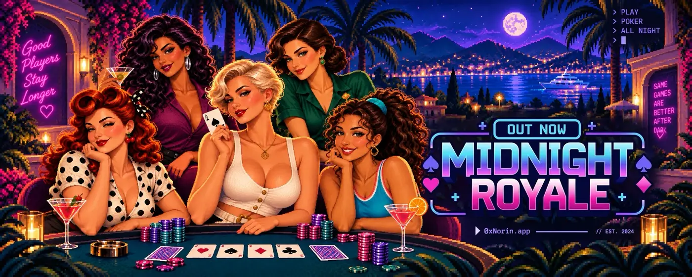
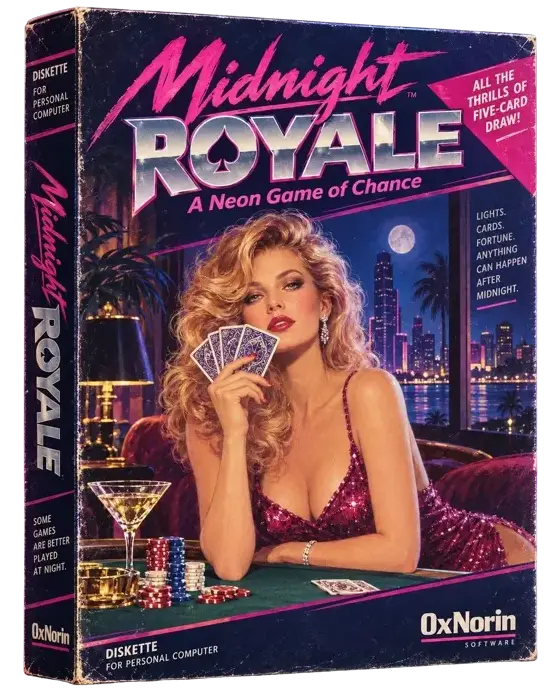
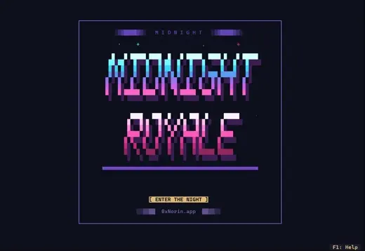
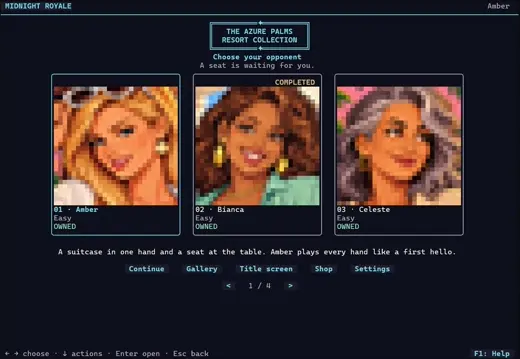
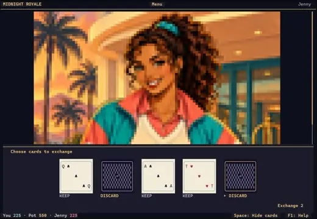
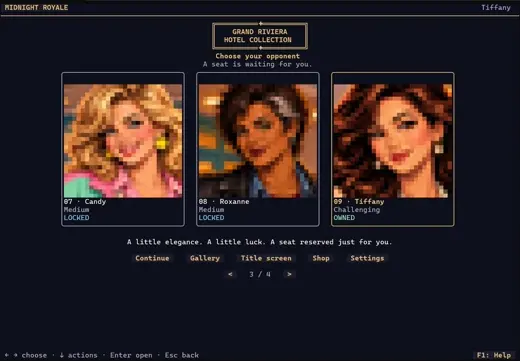

<p align="center">
  
</p>

<h1 align="center">Midnight Royale</h1>

<p align="center">
  <strong>Five-card draw after midnight, in your terminal.</strong><br>
  Thirty-six opponents, three collections, and a neon city that never asks you to go home.
</p>

<p align="center">
  <a href="https://0xnorin.app/midnight-royale/"></a>
  
  <a href="LICENSE"></a>
  
</p>

<p align="center">
  <a href="https://0xnorin.app/midnight-royale/">Play</a> ·
  <a href="https://0xnorin.app/docs/">Manual</a> ·
  <a href="https://0xnorin.app/midnight-royale/changelog/">Changelog</a> ·
  <a href="https://0xnorin.app/docs/midnight-royale/about/licensing/">Licensing</a>
</p>

---

<p align="center">
  
</p>

Midnight Royale is a single-player card game that lives in your terminal — no
browser, no install wizard, no account, and no network connection, ever. You sit
down at the table, play a few hands, and somehow the hours get away from you.

It is written in Go with [Bubble Tea](https://github.com/charmbracelet/bubbletea)
and draws its characters as half-block ANSI art, so a TrueColor terminal is the
whole system requirement.

> **18+** — stylized pixel-art nudity and adult themes. No explicit sexual acts.

## The game

A game of five-card draw against thirty-six women in three collections:

| Collection | Setting |
|---|---|
| **Grand Riviera Hotel** | Neon lobbies, late check-outs, a casino floor that never closes |
| **Azure Palms Resort** | Tropical sunsets, a wooden pier, a pool at midnight |
| **Starlight Lodge** | Snow, warm light and a fire that has been burning for decades |

Each opponent plays her own game — some are reckless, some fold early, and one
or two will take your whole stack while smiling. Win a character run and her
artwork unlocks in the gallery. A **Royal Score** starts at 10,000 for every run
and is paid for with lost hands and stages, so the game is as much about
restraint as about nerve.

Everything is included: every collection, every character, every image. Progress,
personal bests and preferences are saved locally.

<p align="center">
  
  
</p>
<p align="center">
  
  
</p>

## Play

Download a build for your platform from
**[0xnorin.app/midnight-royale](https://0xnorin.app/midnight-royale/)** —
Windows 64-bit, Linux x86_64 and arm64, macOS Apple Silicon and Intel, each
about 16 MB. SHA-256 checksums are published alongside the archives.

The game needs a TrueColor terminal of at least **100 × 35** cells; 104 × 40 or
larger is recommended. A smaller window shows a resize hint instead of the table.

- **Windows:** unzip and run `Start-Midnight-Royale.ps1` (it grows the console for
  you when Windows allows it), or launch `midnight-royale.exe` directly.
- **Linux / macOS:** unzip and run `./midnight-royale`.

Press `F1` (or `?`) at any time for the full control and rules reference.

## Build from source

Requires Go 1.27 or newer.

```bash
cd terminal-ui
go build -o midnight-royale .
./midnight-royale --validate-assets   # verifies 180 scenes / 36 characters
```

There is exactly one build: everything in this tree is 2.1.1, the free edition.
`terminal-ui/VERSION` is the single authoritative version source.

## This repository

| Path | What it is |
|---|---|
| `terminal-ui/` | The game — Go source, embedded artwork, `VERSION` |
| `terminal-ui/internal/` | Poker rules, Royal Score, rendering, saves and gallery |
| `terminal-ui/assets/` | The embedded ANSI scenes and character faces |
| `docs/readme/` | The images at the top of this page |

The artwork pipeline and the source images it converts belong to the
development tree and are not published here; the game ships with the finished
artwork embedded.

## Licence

MIT — see [LICENSE](LICENSE). That covers the game, its source code, its
artwork, its music and sound effects.

Bundled fonts and libraries keep their own licences, which are compatible with
the MIT licence; nothing here relicenses them. See
[`terminal-ui/THIRD-PARTY-NOTICES.txt`](terminal-ui/THIRD-PARTY-NOTICES.txt).

---

<p align="center">
  <a href="https://0xnorin.app/">0xNorin</a>
</p>
